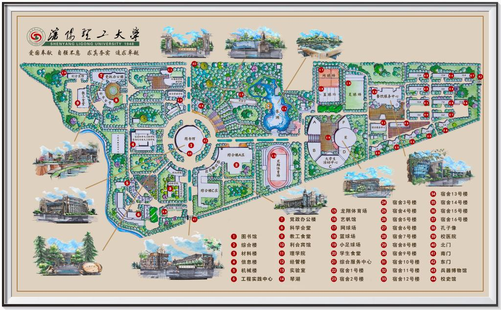

# 兵器寻迹｜沈阳理工大学校园与兵器博物馆数字导览

一份可以直接在浏览器中体验的校园数字导览原型。它把**跟随讲解的主题路线**和**自己选点、安排顺序的自由探索**放在同一张校园地图上，带观众从校园入口走到兵器广场与博物馆。

## 在线体验

### [打开「兵器寻迹」在线导览 ↗](https://damn-fuc.github.io/slgu-campus-guide/)

无需下载、安装或登录。评委打开链接后，在首页选择 **跟我走** 查看三条主题路线，或选择 **我想自己逛** 搜索地点、设置起点和终点并规划自己的游览顺序。地点详情可查看影像、故事与科普内容。

建议使用新版 Chrome 或 Edge 浏览器；部分照片来自公开网页，查看时需要联网。

> 本项目是数字媒体作品原型，不依赖账号、地图服务或服务器。网页主体由 HTML、CSS 和 JavaScript 构成。

## 快速体验

1. 优先打开上方的在线体验链接。
2. 如需离线查看，下载或克隆本项目后，用浏览器打开根目录的 `index.html`。
3. 首页选择 **跟我走** 或 **我想自己逛**，地图上的编号地点均可点选。

页面不需要安装依赖或构建。部分校园照片来自公开网页，查看这些照片需要联网。

## 体验内容

### 跟我走：主题导览

可选择兵器文化、校园人文、校园活力三条路线。按站点顺序浏览图片、讲解和地点故事；途中也可以打开其他地点，再回到原路线继续。

### 我想自己逛：自由探索

地图上的 44 个编号地点均可点选。观众可以搜索地点、按类别筛选，自行设置起点、添加和排序途经点，并选择终点。

### 地点故事与科普

地点详情将校园影像、知识提示和故事内容放在一起。讲解朗读使用浏览器或设备的中文语音合成功能；当前没有人工录音。

## 项目结构

| 路径 | 用途 |
| --- | --- |
| `index.html` | 页面入口、首页与地图视图 |
| `styles/` | 页面样式与响应式布局 |
| `scripts/content.js` | 地点、路线、知识卡片和故事内容 |
| `scripts/navigation.js` | 搜索、筛选、自定义路线和地图交互 |
| `scripts/app.js` | 页面视图与交互状态 |
| `scripts/photos.js`、`scripts/photo-library.js` | 照片卡片、地点影像与来源 |
| `assets/maps/` | 校园地图底图 |
| `assets/photos/`、`assets/audio/` | 经授权后可补入的本地照片与讲解音频 |
| `docs/` | 内容来源、素材记录和设计说明 |

## 地图与内容说明

- 详细地图作为交互底图，来源于项目发起者提供的校园地图；公开发布前需确认其使用许可。
- 地点名称和热点位置依据地图标注整理，部分地点与介绍仍需学校或现场核对。
- 地图上的步行/骑行路线与自行车参考停放点均为示意；不含实时交通、车辆数量或校门开放状态，停放点需现场核实。
- 博物馆展区与藏品信息以现场展签和馆方确认为准；未核实内容会标为演示或待核实。
- 照片来源和使用说明记录在 [`docs/sources.md`](docs/sources.md)、[`docs/photo-sources.md`](docs/photo-sources.md) 与 [`docs/photo-library-attribution.md`](docs/photo-library-attribution.md)。

## 在线发布

本项目已发布到 [GitHub Pages](https://damn-fuc.github.io/slgu-campus-guide/)，网页文件位于仓库根目录，可直接在浏览器访问。更新 `main` 分支后，GitHub Pages 会自动重新发布。

GitHub Pages 的官方说明：[创建 GitHub Pages 网站](https://docs.github.com/en/pages/getting-started-with-github-pages)。

## 参考项目

本项目借鉴以下作品的交互组织思路，没有复制其代码、文字或素材：

- [Map Tour Storytelling Template JS](https://github.com/MehulChoksey/map-tour-storytelling-template-js)：顺序讲解与地图点选并行的路线叙事。
- [Memory Map Toolkit](https://github.com/memorymapper/memorymap-toolkit)：地图热点连接文字、图片和音频的自由探索方式。

## 项目资料

- [素材与资料来源](docs/sources.md)
- [地点影像来源](docs/photo-sources.md)
- [影像资料记录](docs/photo-library-attribution.md)
- [导航与故事内容说明](docs/navigation-and-stories.md)
- [设计稿](docs/superpowers/specs/2026-10-17-weapons-museum-digital-guide-design.md)
